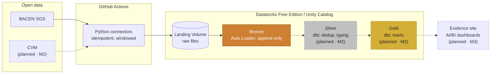

# brazil-finance-lakehouse

[](pyproject.toml)
[](https://github.com/astral-sh/uv)
[](https://github.com/astral-sh/ruff)
[](LICENSE)

A batch + streaming lakehouse on Brazilian public financial data (BACEN, CVM), built on Databricks Free Edition with dbt and GitHub Actions. The end goal is to answer how the Selic rate has tracked inflation since the 90s with a tested pipeline.

This is a portfolio project, so the process (issues, ADRs, small PRs, CI) is part of what it shows.

## What works today

Repo scaffolding (a `uv` project, `ruff` lint and format, `pytest`, pre-commit hooks and a `Makefile`) and a script that sets up the Databricks workspace, described in [docs/setup.md](docs/setup.md). No data pipeline yet. The first one, BACEN SGS landing daily in bronze, is being built in [M1](https://github.com/marcus-brandao/brazil-finance-lakehouse/milestone/1).

## Architecture



Solid: the M1 path, in progress. Dashed: planned for later milestones.

## Stack

| Layer | Tool | Why | Status |
|---|---|---|---|
| Ingestion | Python 3.12, `uv`, GitHub Actions | [ADR-0001](docs/adr/0001-platform.md): Free Edition egress is restricted | 🚧 in progress · M1 |
| Platform | Databricks Free Edition: Unity Catalog, Delta, Auto Loader | [ADR-0001](docs/adr/0001-platform.md) | 🚧 in progress · M1 |
| Transform | dbt | [ADR-0001](docs/adr/0001-platform.md) | ⬜ planned · M2 |
| BI | Evidence, Databricks AI/BI dashboards | [ADR-0001](docs/adr/0001-platform.md) | ⬜ planned · M3 |
| Quality | ruff, pytest, pre-commit | Standard Python tooling, no ADR | ✅ built |

All decisions are in [`docs/adr/`](docs/adr/).

## Design decisions

These are the choices that shape the pipeline. Most of it is still being built, so they describe the design, not shipped features.

- Ingestion runs outside Databricks. Free Edition only allows egress to a short list of trusted domains, so connectors will run on GitHub Actions and push raw files into a Unity Catalog Volume. Databricks takes over from there. ([ADR-0001](docs/adr/0001-platform.md))
- Connectors are idempotent and windowed. The same date window will always write to the same path, so a rerun overwrites instead of duplicating. BACEN SGS caps date-range queries at 10 years, so backfills will go in windows of at most 5 years.
- Bronze is append-only, with the raw payload untouched. Auto Loader will keep it in an envelope. Dedup and typing will happen in silver, so a bug downstream can be fixed by replaying from bronze.
- The Databricks workspace can be thrown away. Free Edition can shut compute down over quota or delete inactive accounts, so code, dbt models, dashboards and bundle config all live in git and can be redeployed into a fresh workspace.
- Every non-obvious choice gets an ADR. Every change starts from an issue with a "Done when" list and lands as a small PR merged with a merge commit.

## Roadmap

Tracked as [milestones](https://github.com/marcus-brandao/brazil-finance-lakehouse/milestones). Only the current one is broken down into stories.

| | Milestone | Focus |
|---|---|---|
| 🚧 | [M1](https://github.com/marcus-brandao/brazil-finance-lakehouse/milestone/1) | Foundations, and BACEN SGS landing daily in bronze with full history |
| ⬜ | [M2](https://github.com/marcus-brandao/brazil-finance-lakehouse/milestone/2) | Silver and gold with dbt, plus more sources |
| ⬜ | [M3](https://github.com/marcus-brandao/brazil-finance-lakehouse/milestone/3) | BI and v1: Evidence site and AI/BI dashboards |
| ⬜ | [M4](https://github.com/marcus-brandao/brazil-finance-lakehouse/milestone/4) | PII and identity resolution, on synthetic seeded data |
| ⬜ | [M5](https://github.com/marcus-brandao/brazil-finance-lakehouse/milestone/5) | Streaming |

✅ done · 🚧 in progress · ⬜ planned

## How to run

There is no pipeline to run yet, only the dev setup. Requires [`uv`](https://docs.astral.sh/uv/).

```bash
git clone https://github.com/marcus-brandao/brazil-finance-lakehouse.git
cd brazil-finance-lakehouse
uv sync
uv run pre-commit install
make lint test
```

## Data sources

Data comes from open sources and is never committed to this repo.

- [BACEN SGS](https://dadosabertos.bcb.gov.br/): Banco Central do Brasil time-series system
- [CVM open data](https://dados.cvm.gov.br/): Comissão de Valores Mobiliários

Both are published under the Open Database License (ODbL); attribution is kept here.

## License

[MIT](LICENSE)
