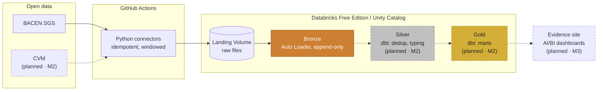

# brazil-finance-lakehouse

A batch + streaming lakehouse on Brazilian public financial data (BACEN, CVM), built on Databricks Free Edition with dbt and GitHub Actions. The end goal is to answer how the Selic rate has tracked inflation since the 90s with a tested pipeline.

This is a portfolio project, so the process (issues, ADRs, small PRs, CI) is part of what it shows.

## What works today

BACEN SGS series 432 (Selic target), 11 (daily Selic), 12 (CDI) and 433 (IPCA) land in `bronze.sgs_raw` every day, with history back to 1995.

- `ingestion/sgs.py` fetches each series in calendar-year windows and writes one file per series and year, with the raw payload inside a wrapper that records the window, `ingested_at` and `run_id`. Re-running a window overwrites the same file. `incremental` starts from a per-series watermark minus a lookback, so revised values are picked up ([ADR-0002](docs/adr/0002-sgs-windows-and-watermark.md)).
- `ingestion/http.py` retries 429, 5xx and connection errors with exponential backoff and jitter, honors `Retry-After` and fails fast on other 4xx.
- `ingestion/upload.py` moves the files and the watermark state to the landing Volume with the Databricks Files API.
- `databricks/bronze_sgs.py` reads the landing files with Auto Loader. A rewritten file comes back as a new row, and silver will keep the newest one ([ADR-0003](docs/adr/0003-bronze-overwritten-files.md)).
- `.github/workflows/ingest.yml` runs all of it at 09:17 UTC and can backfill a single series from the Actions tab ([ADR-0004](docs/adr/0004-ingest-workflow.md)).
- `dbt/` declares `bronze.sgs_raw` as a source with a freshness check and null tests. `make dbt-build` runs them against the Free Edition SQL warehouse ([ADR-0005](docs/adr/0005-where-dbt-runs.md)). There are no models yet.
- CI runs `make lint` and `make test` on every pull request and push to `main`. Tests mock HTTP, so CI needs no secrets, and the run fails if coverage drops below 90%.

The bronze job and the workflow were checked by hand against a Free Edition workspace. The results are in the Verified sections of [docs/bronze.md](docs/bronze.md) and [docs/ingest.md](docs/ingest.md).

## Architecture

Solid: built in M1. Dashed: planned for later milestones.

## Stack

| Layer | Tool | Why | Status |
|---|---|---|---|
| Ingestion | Python 3.12, `uv`, GitHub Actions | [ADR-0001](docs/adr/0001-platform.md): Free Edition egress is restricted | ✅ built · M1 |
| Platform | Databricks Free Edition: Unity Catalog, Delta, Auto Loader | [ADR-0001](docs/adr/0001-platform.md) | ✅ built · M1 |
| Transform | dbt | [ADR-0001](docs/adr/0001-platform.md), [ADR-0005](docs/adr/0005-where-dbt-runs.md) | 🚧 in progress · M2 |
| BI | Evidence, Databricks AI/BI dashboards | [ADR-0001](docs/adr/0001-platform.md) | ⬜ planned · M3 |
| Quality | ruff, pytest, pytest-cov, pre-commit, GitHub Actions CI | Standard Python tooling, no ADR | ✅ built |

All decisions are in [`docs/adr/`](docs/adr/).

## Design decisions

These are the choices that shape the pipeline. Silver, gold and the dbt and bundle parts arrive in later milestones.

- Ingestion runs outside Databricks. Free Edition only allows egress to a short list of trusted domains, so the connectors run on GitHub Actions and push raw files into a Unity Catalog Volume. Databricks takes over from there ([ADR-0001](docs/adr/0001-platform.md)).
- Connectors are idempotent and windowed. A date window always writes to the same path, so a rerun overwrites instead of duplicating. SGS refuses ranges over 10 years for daily series, and the connector asks for one calendar year at a time ([ADR-0002](docs/adr/0002-sgs-windows-and-watermark.md)).
- Bronze is append-only and keeps the raw payload untouched in an envelope. Dedup and typing happen in silver, so a bug downstream can be fixed by replaying from bronze.
- The Databricks workspace can be thrown away. Free Edition can shut compute down over quota or delete inactive accounts, so code, dbt models, dashboards and bundle config live in git and can be redeployed into a fresh workspace ([docs/setup.md](docs/setup.md#rebuilding)).
- Every non-obvious choice gets an ADR. Every change starts from an issue with a "Done when" list and lands as a small PR merged with a merge commit.

## Roadmap

Tracked as [milestones](https://github.com/marcus-brandao/brazil-finance-lakehouse/milestones). Only the current one is broken down into stories.

| | Milestone | Focus |
|---|---|---|
| ✅ | [M1](https://github.com/marcus-brandao/brazil-finance-lakehouse/milestone/1) | Foundations, and BACEN SGS landing daily in bronze with full history |
| 🚧 | [M2](https://github.com/marcus-brandao/brazil-finance-lakehouse/milestone/2) | Silver and gold with dbt, plus more sources |
| ⬜ | [M3](https://github.com/marcus-brandao/brazil-finance-lakehouse/milestone/3) | BI and v1: Evidence site and AI/BI dashboards |
| ⬜ | [M4](https://github.com/marcus-brandao/brazil-finance-lakehouse/milestone/4) | PII and identity resolution, on synthetic seeded data |
| ⬜ | [M5](https://github.com/marcus-brandao/brazil-finance-lakehouse/milestone/5) | Streaming |

✅ done · 🚧 in progress · ⬜ planned

## How to run

Requires [`uv`](https://docs.astral.sh/uv/) and a [Databricks Free Edition](https://docs.databricks.com/aws/en/getting-started/free-edition) workspace.

1. Clone the repo, then run `uv sync`, `uv run pre-commit install` and `make lint test`.
2. Set up the workspace, the `.env` file and the GitHub secrets with [docs/setup.md](docs/setup.md).
3. Create the bronze job with `databricks/create_bronze_job.py` ([docs/bronze.md](docs/bronze.md#deploy)).
4. In the Actions tab, run Ingest SGS with mode `backfill` and a start date. The daily schedule takes over from there ([docs/ingest.md](docs/ingest.md)).

## Docs

- [docs/setup.md](docs/setup.md): workspace, catalog, Volume and secrets
- [docs/ingest.md](docs/ingest.md): the daily workflow, manual runs and its checks
- [docs/bronze.md](docs/bronze.md): the bronze job, the reconciliation query and its checks
- [docs/adr/](docs/adr/): architecture decision records
- [docs/tech-debt.md](docs/tech-debt.md): known shortcuts

## Data sources

Data comes from open sources and is never committed to this repo.

- [BACEN SGS](https://dadosabertos.bcb.gov.br/): Banco Central do Brasil time-series system
- [CVM open data](https://dados.cvm.gov.br/): Comissão de Valores Mobiliários

Both are published under the Open Database License (ODbL); attribution is kept here.

## License

[MIT](LICENSE)
